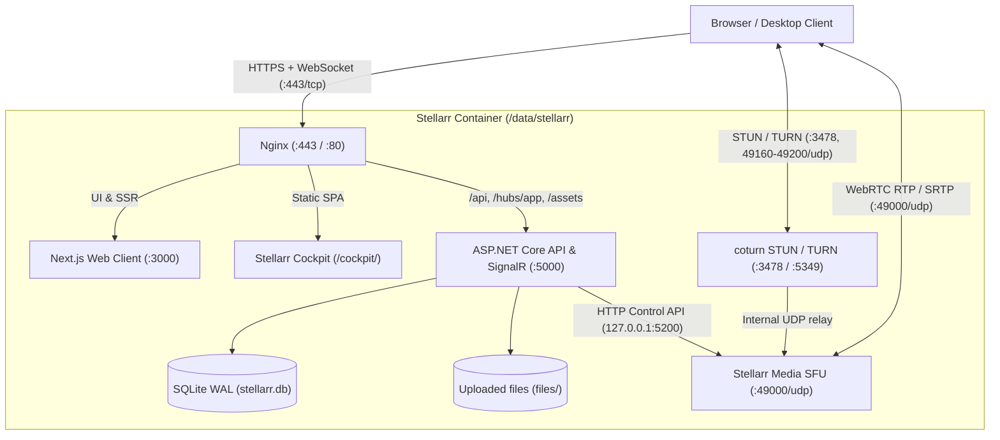

# Architecture

Stellarr runs inside a single Docker container backed by one persistent volume (`/data/stellarr`). Every HTTP request enters through Nginx, while WebRTC voice and video traffic goes directly to `stellarr-media` (or through `coturn` when UDP hole punching fails).

See [Voice and RTC protocol](./rtc-protocol.md) for client state and signaling messages, and [Stellarr Media](./stellarr-media.md) for the Rust SFU media server.

## System overview

## Component responsibilities

- **Next.js (`web/`)**: Serves the web application and implements the browser-side `VoiceClient`. React components read call state from `VoiceState` and trigger actions through `VoiceClient`.
- **Stellarr Cockpit (`cockpit/`)**: Standalone single-page operator panel served statically by Nginx under `/cockpit/` (`/ops/` redirects with `308`). Calls `/api/cockpit/*` and requires the built-in instance owner role.
- **ASP.NET Core (`server/Stellarr.Api`)**: Application server handling authentication, sessions, servers, channels, public and direct messages, uploads, presence, and SignalR signaling. It also opens and closes media sessions on `stellarr-media` via its loopback HTTP API and relays SDP/ICE negotiation between browsers and the media server.
- **Operator CLI (`server/Stellarr.Cli`)**: The `stellarr` binary included in the container image. It inspects instance health and manages settings, encrypted secrets, and user sessions directly against the data volume without starting a second API process. See [Operator CLI](./install/cli.md).
- **SQLite**: Stores relational application state in WAL mode (`stellarr.db`). Binary attachments are never stored in SQLite.
- **Uploaded files**: Images, audio, video, and documents are plain files under `/data/stellarr/files/`, each at the path its object key names (for example `audio/2026/11/<id>.webm`). The API writes a file to `files/.incoming/`, flushes it to disk, and only then moves it into place, so a half-written upload never appears under its key. The database records what each file is; clients never read the folder directly, and the API authorizes and streams every download.
- **coturn**: Provides STUN and short-lived HMAC-authenticated TURN relay. It holds no room or application state and relays TURN allocations directly to the local `stellarr-media` UDP socket.
- **Stellarr Media (`media/`, Rust)**: Selective Forwarding Unit (SFU) that carries all call media. It listens on a single UDP port (`49000/udp`) using ICE-lite, terminates DTLS/SRTP per client, and forwards microphone, camera, and screen-share RTP packets without transcoding or mixing while handling per-leg RTCP feedback (NACK, RTX, TWCC, PLI/FIR). Controlled by the API over `127.0.0.1:5200`.

> [!NOTE]
> Because `stellarr-media` terminates SRTP on each connection to forward packets between participants, call audio and video are decrypted in the media server's memory on your host and are not end-to-end encrypted between browsers.

## Account security

Every way in (password, passkey, registration, an OIDC provider, and the desktop app's browser sign-in) ends in one authentication decision. A completed first proof either opens a revocable session or, when a second step or a first method is due, a short-lived challenge bound to the browser; only a session can call the API or join the hubs. A session records how it began, when its second step last happened, its security version, and an absolute end that renewing the cookie cannot pass. A sign-in without "Keep me signed in" gets a cookie that ends with the browser and a session that ends after 12 hours.

The second steps are an authenticator app (TOTP), a code by email, a passkey or security key, and single-use recovery codes. Passkeys are checked with Fido2 against the host of `Operations:PublicUrl`, never the request's `Host`, and a passkey sign-in requires user verification, so it counts as both steps. TOTP seeds and email codes are encrypted with the instance's data-protection keys; recovery codes and trusted-device tokens are stored only as digests. Changes that could hand the instance or an account to someone else need a second step from the last five minutes in the same session, and a remembered trusted device never counts as one.

The API reads revoked sessions and role or policy changes from the database at most once per second and closes the matching WebSocket connections, which ends their voice and media sessions. Security events are recorded per account, and verified addresses can be alerted through the configured mail transport. See [Account security](./install/account-security.md) for the policies and for recovering a locked-out account.

## Single-container deployment

`supervisord` (`infra/supervisord.conf`) supervises all runtime processes (Stellarr Media, ASP.NET Core, Next.js, `coturn`, Nginx, and `stellarr-tls-maintenance`) inside one container image backed by `/data/stellarr`. Nginx exposes a single HTTPS origin externally.

> [!TIP]
> Keeping all services in one container simplifies self-hosting and backups to a single Docker volume. If you ever need to split media onto a separate machine, `stellarr-media` and `coturn` communicate with the API only over their network protocols and can be moved without changing the browser client.
