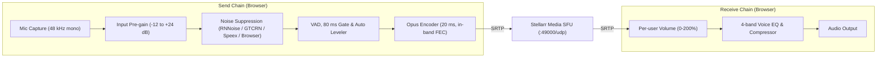

# RTC and ports

Protocol messages and client state are described in [Voice and RTC protocol](./rtc-protocol.md), and the Rust SFU media server in [Stellarr Media](./stellarr-media.md). This page covers host and container ports, NAT/TURN setup, the client audio/video pipeline, and call troubleshooting.

## Published host ports

| Default port | Protocol | Process | Purpose |
| --- | --- | --- | --- |
| `8888` | TCP | Nginx | HTTP redirect to HTTPS (`STELLARR_HTTP_PORT`) |
| `8443` | TCP | Nginx | HTTPS: web client, API, SignalR WebSocket, and Cockpit (`STELLARR_HTTPS_PORT`) |
| `3478` | UDP, TCP | `coturn` | STUN and TURN (`STELLARR_TURN_PORT`) |
| `5349` | UDP, TCP | `coturn` | TURN over TLS/DTLS (`STELLARR_TURNS_PORT`) |
| `49000` | UDP | `stellarr-media` | Media server port (`STELLARR_MEDIA_PORT`); carries every call |
| `49160-49200` | UDP | `coturn` | TURN relay port range (`STELLARR_TURN_RELAY_RANGE`) |

- `STELLARR_HTTPS_PORT` is included in HTTP-to-HTTPS redirects (omitted when set to `443`). Requests forwarded by an upstream TLS proxy with `X-Forwarded-Proto: https` are not redirected.
- `STELLARR_TURN_PORT`, `STELLARR_TURNS_PORT`, and `STELLARR_MEDIA_PORT` set both the published host port and the port advertised to browsers. Your router must forward the same external UDP port to `STELLARR_MEDIA_PORT`.
- `STELLARR_TURN_TCP_ENABLED` defaults to `false`. Disabled transports are turned off in `/etc/turnserver.conf` (`no-tcp`, `no-tls`, `no-dtls`) and omitted from `/api/bootstrap`.

> [!NOTE]
> `STELLARR_TURNS_ENABLED` defaults to `false` (`Rtc:TurnsEnabled=false`) because browsers reject self-signed certificates on `turns:` URLs. Enable it only after mounting a CA-signed certificate in `/data/stellarr/tls/`.

### Relay port sizing

The default relay range (`49160-49200/udp`) provides 41 UDP ports. Each browser opens a single peer connection to `stellarr-media`, requiring at most 1 TURN allocation per participant (~5 ports for a 5-person call), relayed internally to the container's local UDP socket.

To expand the relay range for larger instances or TURN/TCP, update `min-port`/`max-port` in `infra/turnserver.conf.template`, `ports` in `docker-compose.yml`, `EXPOSE` in `Dockerfile`, and your host/router firewall rules.

## Container-internal ports

| Port | Service |
| --- | --- |
| `3000/tcp` | Next.js standalone server (`127.0.0.1`) |
| `5000/tcp` | ASP.NET Core API and SignalR (`127.0.0.1`) |
| `5200/tcp` | `stellarr-media` HTTP control API (`127.0.0.1`, authenticated via `secrets/media-control-secret`) |

Nginx routes `/api/`, `/assets/`, `/health`, `/hubs/`, and `/.well-known/stellarr/client` to ASP.NET Core, serves Cockpit statically from `/cockpit/`, proxies `/bergamot-models-gcs/` to the Bergamot model bucket, and forwards all other HTTP paths to Next.js.

## NAT and firewall configuration

Nginx only proxies HTTP and WebSocket traffic; WebRTC STUN, TURN, and SFU UDP packets bypass HTTP proxies and must reach the Docker host directly.

Forward on your router to the Docker host:

- TCP `80/443` (or your external `STELLARR_HTTP_PORT` / `STELLARR_HTTPS_PORT`)
- UDP `3478` (and TCP `3478` if `STELLARR_TURN_TCP_ENABLED=true`)
- UDP/TCP `5349` (if `STELLARR_TURNS_ENABLED=true`)
- UDP `49160-49200`
- UDP `49000` (or `STELLARR_MEDIA_PORT`), on the same external port

Recommended `.env` settings behind NAT:

```bash
STELLARR_DOMAIN=chat.example.com
PUBLIC_IP=auto          # or a static public IPv4 address
STELLARR_MEDIA_PORT=49000
```

- `PUBLIC_IP` sets `external-ip` in `coturn` and the public host candidate in `stellarr-media`. `PUBLIC_IP=auto` resolves the IPv4 `A` record of `STELLARR_DOMAIN` at container startup and exits if resolution fails.
- `stellarr-media` advertises `PUBLIC_IP:STELLARR_MEDIA_PORT` followed by the container's local IPv4 address on port `49000` (used when `coturn` relays a TURN client inside the container).
- The API issues short-lived (1-hour) HMAC-derived TURN credentials to authenticated users; the static shared secret never leaves the container.

> [!WARNING]
> If `PUBLIC_IP` is unset, `stellarr-media` advertises only the container's internal IPv4 address. Any browser outside the Docker host can then connect only through TURN (`coturn`), and the container logs a startup warning.

## Audio and video pipeline

### Opus bitrate profiles

| Profile | Max bitrate | Min adaptation bitrate | Channels | DTX | In-band FEC | Packet time |
| --- | ---: | ---: | --- | --- | --- | ---: |
| Economy | 32 kb/s | 16 kb/s | mono | yes | yes | 20 ms |
| Balanced | 64 kb/s | 24 kb/s | mono | no | yes | 20 ms |
| Clarity | 96 kb/s | 32 kb/s | mono | no | yes | 20 ms |
| Premium (default) | 128 kb/s | 64 kb/s | mono | no | yes | 20 ms |
| Studio | 256 kb/s | 96 kb/s | mono | no | yes | 20 ms |
| Screen audio | 160 kb/s | 96 kb/s | stereo (when negotiated) | no | yes | 20 ms |

WebRTC handles fast congestion control; the client adjusts the Opus bitrate ceiling gradually from smoothed packet-loss and RTT stats (`RTCRtpSender.getStats()` / `setParameters()`) with hysteresis.

### Capture, processing, and playback chain



1. **Capture**: `getUserMedia` at 48 kHz mono.
2. **Input gain**: Fixed pre-gain (`-12 dB` to `+24 dB`).
3. **Noise suppression**: Five selectable modes: `rnnoise` (default), `gtcrn`, `speex` (all running locally as WASM in an `AudioWorklet` from `web/public/audio/`), `browser` (native WebRTC processing), or `off`. If a WASM worklet fails to initialize, the pipeline falls back to native browser processing and shows a degraded indicator.
4. **Speech detection (VAD), input gate, and leveler**:
   - The audio-thread detector analyzes 10 ms frames using noise-floor estimation, hysteresis, hangover, and transient/click rejection (peak-to-RMS ratio and pitch check between 60–400 Hz).
   - The **input gate** (enabled by default) uses an 80 ms lookahead buffer so word onsets are not clipped, attenuating inter-sentence noise to silence after a 600 ms hold without stopping the RTP stream.
   - The **automatic leveler** updates gain only during voiced frames so background noise is not amplified between utterances.
5. **Receive chain**: Remote microphone tracks pass through per-user volume controls (`0–200%`) and an optional Web Audio EQ + compressor with automatic make-up gain (`Off`, `Natural`, `Studio`, `Broadcast`, or `Custom` ±12 dB at 160 Hz, 360 Hz, 3.1 kHz, and 8 kHz). Screen-share audio bypasses voice EQ.
6. **Per-account storage**: Device and voice processing settings are scoped by account ID in `localStorage`.

### Screen sharing

Four profiles are defined in `web/src/lib/voice/screenShare.ts`, from `720p15` (1 Mb/s) to `2160p60` (12 Mb/s), defaulting to `1080p30` (2.5 Mb/s). VP9 with temporal scalability layers is preferred, and video senders use lower network priority than Opus audio. The sender uploads a single stream that `stellarr-media` forwards to all receivers.

## Diagnostics

When voice fails to connect, check in order:

1. The page is loaded over `https://` (or `http://localhost`).
2. Microphone permissions are granted in the browser.
3. `GET /api/bootstrap` returns `rtc.mediaServer` with the expected host and port.
4. `PUBLIC_IP` matches the host's public IPv4 address, and the container logs show no empty-`PUBLIC_IP` warning.
5. `49000/udp` (`STELLARR_MEDIA_PORT`) is forwarded to the host on the same external UDP port.
6. `3478/udp` (`STELLARR_TURN_PORT`) is reachable from the client network.
7. `49160-49200/udp` (`STELLARR_TURN_RELAY_RANGE`) is open in the host firewall and forwarded on the router.
8. Container logs show the `media` service running.
9. Clients receive `MediaSignal` events on `/hubs/app`.
10. `stellarr-media` lists active sessions as `connected` with advancing `ingress` and `egress` counters:

    ```bash
    docker compose exec stellarr sh -c \
      'curl -s -H "Authorization: Bearer $(cat /data/stellarr/secrets/media-control-secret)" http://127.0.0.1:5200/v1/stats'
    ```
