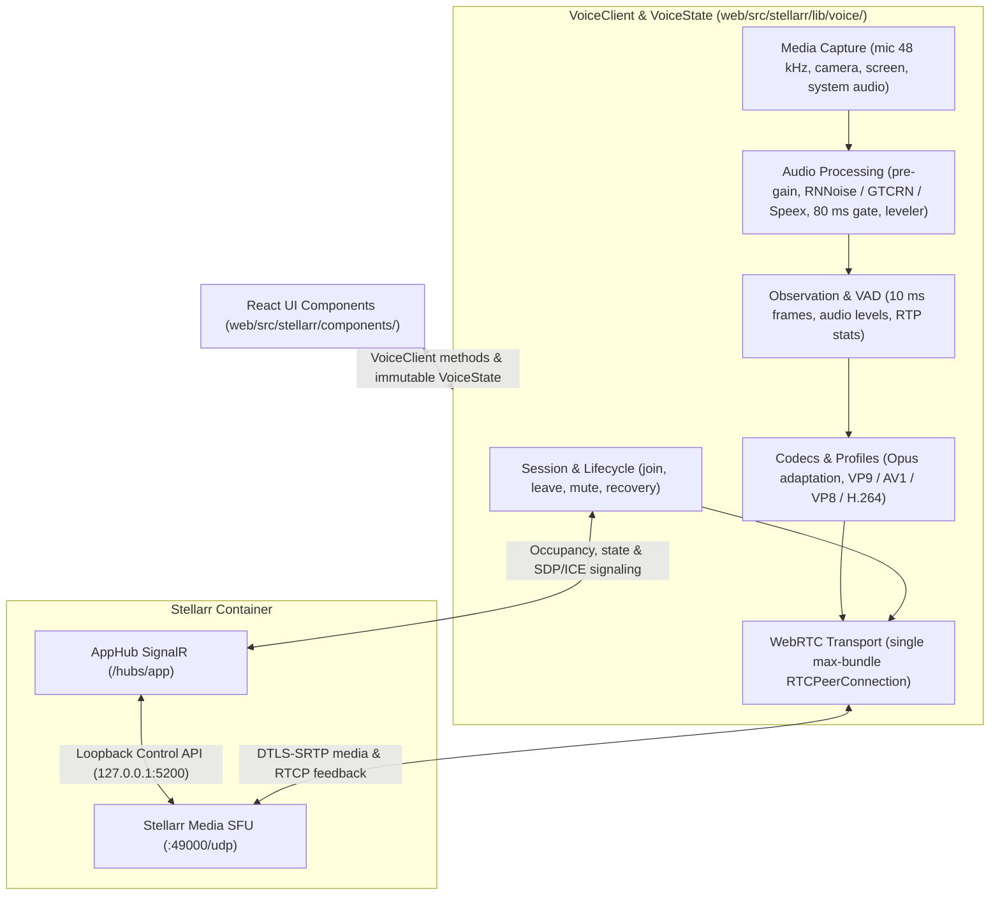
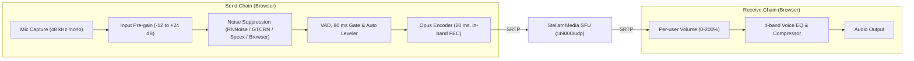

# Voice and RTC protocol

This page describes how the web client (`VoiceClient`), the SignalR hub (`AppHub`), and the media server interact during voice and video calls. All call media flows through Stellarr Media (`stellarr-media`); see [Stellarr Media](./stellarr-media.md) for SFU negotiation, track attribution, and the loopback control API.

## Client and signaling layers



UI components interact only with `VoiceClient` and immutable `VoiceState` snapshots; they never import SignalR, `RTCPeerConnection`, audio worklets, or media-server internals directly.

## Bootstrap configuration

`GET /api/bootstrap` returns the `rtc` configuration object:

```json
{
  "protocolVersion": 1,
  "capabilities": {
    "audioCodecs": ["opus"],
    "videoCodecs": ["vp9", "vp8", "h264"],
    "audioProcessing": ["browser", "rnnoise", "gtcrn", "speex", "gate"],
    "camera": true,
    "screenShare": true,
    "screenAudio": true
  },
  "iceServers": [],
  "signalingHub": "/hubs/app",
  "mediaServer": "udp://chat.example.com:49000"
}
```

- `iceServers` is populated per request with a STUN URL, an HMAC-authenticated TURN URL, and (when `Rtc:TurnsEnabled` is `true`) a `turns:` URL.
- `mediaServer` is `udp://<Rtc:PublicHost>:<Rtc:MediaPort>`.
- The client validates `protocolVersion === 1` before opening media devices and stops with an `unsupported` error otherwise.

## Signaling

`VoiceSignal` broadcasts a participant's mute and stream state to others in the room:

```json
{
  "protocolVersion": 1,
  "channelId": "uuid",
  "fromUserId": "uuid",
  "toUserId": "uuid",
  "kind": "state",
  "payload": "JSON string"
}
```

- `channelId` identifies an RTC room: either a server voice channel or a two-user direct conversation.
- Clients omit `fromUserId`; `AppHub` populates it from the authenticated session. When `toUserId` is omitted, the signal broadcasts to all other participants in the room.
- The backend validates authentication, room membership, recipient membership, `protocolVersion`, `kind`, and a 128 KiB payload limit.
- Occupancy updates (`VoiceParticipantChanged`) for server voice channels broadcast to the server; direct-call occupancy updates go only to the two participants.
- Declining a direct call (`DeclineDirectCall`) clears room occupancy and sends `DirectCallDeclined` so the caller releases capture devices.
- Payloads are validated by typed codecs (`web/src/stellarr/lib/rtc/protocol.ts`). A `state` payload has `{ muted, screenStreamId, cameraStreamId, encrypted }` (`cameraStreamId` is optional, absence means camera off; `encrypted` is optional, absence means the sender does not encrypt its frames). A client in a private call that does not encrypt plays nothing of the other person until their `state` says whether they encrypt, and follows one who does into encryption (see [End-to-end encrypted calls](./stellarr-media.md#end-to-end-encrypted-calls)).

> [!NOTE]
> `SendVoiceSignal` accepts only `kind: "state"`. `AppHub` rejects `offer`, `answer`, and `candidate` with `HubException("Invalid voice signal.")`. SDP descriptions and ICE candidates flow exclusively via `OpenMediaSession`, `SendMediaSignal`, `MediaSignal`, and `MediaSessionClosed` (see [Stellarr Media](./stellarr-media.md#hub-leg)).

Breaking changes to the envelope or payload require incrementing `protocolVersion`. Optional fields may be added within version `1`.

### Hub methods and events

Defined in `web/src/stellarr/lib/rtc/protocol.ts` and implemented by `AppHub` in `server/Stellarr.Api/Realtime/`:

| Type | Name | Description |
| --- | --- | --- |
| Method | `JoinVoice` | Take a seat in a voice channel or direct call |
| Method | `LeaveVoice` | Leave the current voice seat |
| Method | `SendVoiceSignal` | Relay a `state` `VoiceSignal` to one participant or the room |
| Method | `DeclineDirectCall` | End a ringing/active direct call for both participants |
| Method | `PlaySoundboard` | Schedule a soundboard clip in the room |
| Method | `GetRtcClock` | Return server Unix timestamp in milliseconds |
| Method | `OpenMediaSession` | Open a media session with Stellarr Media for the caller's seat |
| Method | `SendMediaSignal` | Send an SDP offer/answer, ICE candidate, or receive subscriptions to `stellarr-media` |
| Event | `VoiceParticipantChanged` | Room occupancy snapshot: `{ channelId, sequence, participants }` |
| Event | `VoiceSignal` | Relayed `VoiceSignal` envelope |
| Event | `VoiceSessionReplaced` | Account joined voice from a newer browser tab |
| Event | `DirectCallDeclined` | Remote participant declined the direct call |
| Event | `SoundboardPlayed` | Scheduled soundboard clip broadcast |
| Event | `JoinSoundPlayed` | Scheduled arrival sound broadcast |
| Event | `SoundboardChanged` | Server soundboard catalog updated |
| Event | `MediaSignal` | SDP offer/answer or track directory from `stellarr-media` |
| Event | `MediaSessionClosed` | Stellarr Media ended the caller's media session |

Clients ignore any `VoiceParticipantChanged` snapshot whose `sequence` is older than the highest sequence already applied for that room.

### Soundboard synchronization

Soundboard clips synchronize over SignalR rather than mixing into microphone audio:

- `GET /api/soundboard` returns the server's sounds in their saved order, the two rules (`everyoneCanPlay`, `rateLimited`), `canManage`, and `canPlay`: whether the caller may play them, decided by the same rule (`SoundboardAccess`) the hub applies.
- `PUT /api/admin/soundboard/order` with `{ "soundIds": [...] }` sets that order. It needs `ManageServer`, like the other admin soundboard calls, and the list must name every sound of the server exactly once, or the call answers `400`. A saved order broadcasts `SoundboardChanged`.
- `PlaySoundboard(channelId, soundId)` verifies the caller's seat in a server voice channel and the play rule: with `everyoneCanPlay` off, only `ManageServer`, `ManageMessages` or `ModerateMembers` may play. Private calls are refused.
- With `rateLimited` on, each person gets one play per 5 seconds per server, shared by all their connections; with it off there is no cooldown.
- `GetRtcClock()` estimates client-server clock offset using half the round-trip time.
- `SoundboardPlayed` carries clip metadata and a `startsAtUnixMs` timestamp scheduled `750 ms` in the future.
- Each receiver fetches/decodes the clip and schedules playback in `AudioContext`, trimming the leading offset if the event arrived late.

### Arrival sound

Users can pick a personal arrival clip (`UserPreferences.JoinSoundId`) from any server they belong to:

- Membership in the clip's source server is verified when saving preferences and on `JoinVoice`.
- `JoinSoundPlayed` reuses `SoundboardPlayedDto` (`startsAtUnixMs` +750 ms), capped at `JoinSound.MaxSeconds` (`5 s`) and rate-limited by `JoinSound.Cooldown` (`30 s` per user; cooldown skips the clip without blocking join).
- `AttachmentAccess` permits downloading the clip when the listener shares a server or DM conversation with its owner.
- The local `joinLeaveSound` preference mutes both standard join/leave tones and remote arrival clips (`setArrivalsAudible`).

## State model

`VoiceState` separates SignalR signaling state from WebRTC media transport state:

| Field | Values | Meaning |
| --- | --- | --- |
| `transport.signaling` | `idle`, `connecting`, `connected`, `reconnecting`, `disconnected` | SignalR hub connectivity and negotiation readiness |
| `transport.media` | `idle`, `ready`, `connecting`, `connected`, `degraded`, `failed` | Aggregate WebRTC media transport health |
| `peerCount` | `number` | Number of remote participants seated in the room |
| `connectedPeerCount` | `number` | Number of remote participants with active incoming audio |

- `transport.media = ready`: local media session is connected with `peerCount === 0`.
- `transport.media = degraded`: a remote participant's audio has not arrived within its 3-second grace window, or session replacement is in progress (see [Proving media quickly](./stellarr-media.md#proving-media-quickly)).
- When `stellarr-media` holds back a remote video stream due to receiver downlink limits, the corresponding `VoicePeer` camera or screen sets `heldBack: true`, and the UI suppresses the frozen video element rather than leaving a stale frame on screen.

> [!IMPORTANT]
> Only one active voice session is allowed per account across tabs and devices. Joining from a second tab replaces the earlier seat and sends `VoiceSessionReplaced` to the previous connection.

## Audio

### Opus bitrate profiles

| Profile | Max bitrate | Min adaptation bitrate | Channels | DTX | In-band FEC | Packet time |
| --- | ---: | ---: | --- | --- | --- | ---: |
| Economy | 32 kb/s | 16 kb/s | mono | yes | yes | 20 ms |
| Balanced | 64 kb/s | 24 kb/s | mono | no | yes | 20 ms |
| Clarity | 96 kb/s | 32 kb/s | mono | no | yes | 20 ms |
| Premium (default) | 128 kb/s | 64 kb/s | mono | no | yes | 20 ms |
| Studio | 256 kb/s | 96 kb/s | mono | no | yes | 20 ms |
| Screen audio | 160 kb/s | 96 kb/s | stereo (when negotiated) | no | yes | 20 ms |

WebRTC handles fast congestion control, while the client adapts the Opus bitrate ceiling gradually from smoothed packet-loss and RTT stats (`RTCRtpSender.getStats()` / `setParameters()`) with hysteresis.

### Capture, processing, and playback chain



1. **Capture and gain**: `getUserMedia` at `48 kHz` mono, followed by fixed pre-gain (`-12 dB` to `+24 dB`).
2. **Noise suppression**: `browser` (default), `rnnoise`, `gtcrn`, `speex` (local WASM `AudioWorklet`s served from `/audio/`: the binaries are built in the repository by `artifacts/recipes/speex/`, `artifacts/recipes/rnnoise/` and `artifacts/recipes/gtcrn/`, and the worklets from `web/src/stellarr/lib/voice/capture/speex/`, `.../rnnoise/` and `.../gtcrn/`), or `off`. Worklet failures fall back to `browser` with a degraded indicator. An engine's binary is fetched once the choice has stayed put for 700 ms, in a call or not, and the noise button in the call dock and the chosen option in voice settings carry a ring showing how far the download has come; a mode only passed on the way to another is neither fetched nor captured.
3. **VAD, input gate, and leveler**:
   - The audio-thread detector inspects `10 ms` frames using noise-floor estimation, hysteresis, hangover, and transient/click rejection (peak-to-RMS ratio and `60–400 Hz` pitch check). Speech detection never mutes the track or stops RTP packets.
   - The **input gate** (on by default) uses an `80 ms` lookahead buffer and `600 ms` hold time, attenuating silence without stopping continuous RTP.
   - The **automatic leveler** updates gain only on voiced frames so background noise is not amplified.
4. **Source separation**: Microphone and screen-share audio use separate tracks, separate Opus profiles (`web/src/stellarr/lib/voice/audioProfiles.ts`), and separate playback elements. Muting affects only the microphone.
5. **Receive chain**: Remote microphones pass through per-user volume (`0–200%`) and optional Web Audio 4-band EQ + compressor (`Off`, `Natural`, `Studio`, `Broadcast`, or `Custom` `±12 dB` at `160 Hz`, `360 Hz`, `3.1 kHz`, and `8 kHz`). Screen-share audio bypasses voice EQ.
6. **Per-account storage and resilience**: Device and audio settings are stored per account ID in `localStorage`. Hiding/restoring a browser tab never tears down healthy connections, and long calls refresh TURN credentials before expiry.

## Screen sharing

| Profile | Max resolution | Max frame rate | Max bitrate |
| --- | ---: | ---: | ---: |
| Economy | 720p | 15 fps | 1 Mb/s |
| Balanced (default) | 1080p | 30 fps | 2.5 Mb/s |
| Sharp | 1440p | 30 fps | 5 Mb/s |
| Ultra | 2160p | 60 fps | 12 Mb/s |

- Profiles live in `web/src/stellarr/lib/voice/video/screenShare.ts` and update both `getDisplayMedia` constraints and `RTCRtpSender` parameters live without renegotiation or re-prompting.
- Codec preference order: VP9 (2–3 temporal layers when supported), AV1, VP8, H.264.
- Uses `contentHint = "detail"` and `degradationPreference = "maintain-resolution"`, with `medium` network priority (below Opus `high`).
- **Opt-in forwarding**: `stellarr-media` forwards screen video and screen audio only to receivers watching that share ([receive subscriptions](./stellarr-media.md#receive-subscriptions)). New shares start unwatched, and stopping watching halts forwarding without affecting the publisher.
- **Whole-track caps**: Profiles are upper bitrate limits. Tracks forward whole without per-receiver transcoding or simulcast selection.
- **Low-bandwidth pause**: If a receiver's downlink lacks headroom ([downlink adaptation](./stellarr-media.md#downlink-adaptation)), `stellarr-media` holds the video back (`heldBack: true`) and the UI shows a paused notice until capacity recovers.

## Camera

| Profile | Resolution | Frame rate | Max bitrate |
| --- | --- | ---: | ---: |
| Low | 854×480 | 24 fps | 0.7 Mb/s |
| Standard (default) | 1280×720 | 30 fps | 1.5 Mb/s |
| High | 1920×1080 | 30 fps | 3.0 Mb/s |

- Managed by `VoiceClient` (`web/src/stellarr/lib/voice/video/camera.ts`), capturing video only with `contentHint = "motion"` and `degradationPreference = "maintain-framerate"`.
- Camera video shares a single `MediaStream` with the microphone (`cameraStreamId`) for A/V sync; screen shares use a separate `MediaStream` (`screenStreamId`).
- Switching camera devices uses `RTCRtpSender.replaceTrack` without SDP renegotiation; camera failures never interrupt voice audio.
- Receivers prioritize subscriptions as: voices → watched screen share → cameras. If a receiver's downlink cannot carry a camera, `stellarr-media` sets `VoiceCamera.heldBack` and the UI falls back to the speaker's avatar with a paused-video indicator until bandwidth returns.

## Key source files

| Area | Source files |
| --- | --- |
| Wire protocol & payload codecs | `web/src/stellarr/lib/rtc/protocol.ts`, `server/Stellarr.Api/Realtime/RtcProtocol.cs` |
| Client interface | `web/src/stellarr/lib/voice/types.ts` (`VoiceClient`, `VoiceState`) |
| State store | `web/src/stellarr/lib/voice/store.ts` (`VoiceStateStore`) |
| Call session management | `web/src/stellarr/lib/voice/rtc/webrtc.ts`, `web/src/stellarr/lib/voice/rtc/webrtcTopology.ts`, `web/src/stellarr/lib/voice/rtc/webrtcParticipant.ts` |
| Media server client | `web/src/stellarr/lib/voice/rtc/webrtcSfu.ts`, `web/src/stellarr/lib/voice/rtc/webrtcSfuDirectory.ts`, `web/src/stellarr/lib/voice/rtc/webrtcSfuHealth.ts` |
| Soundboard & arrival sounds | `web/src/stellarr/adapters/soundboard.ts`, `web/src/stellarr/containers/useJoinSound.ts`, `SoundboardEndpoints.cs`, `SoundboardAccess.cs`, `JoinSound.cs`, `AppHub.cs` |
| Opus, screen, and camera profiles | `web/src/stellarr/lib/voice/audioProfiles.ts`, `web/src/stellarr/lib/voice/video/screenShare.ts`, `web/src/stellarr/lib/voice/video/camera.ts` |
| Microphone DSP & VAD | `web/src/stellarr/lib/voice/capture/micPipeline.ts`, `web/src/stellarr/lib/voice/capture/vad.ts`, `web/src/stellarr/lib/voice/capture/detector/` (built into `/audio/detector-worklet.js`) |
| ICE/TURN credential refresh | `web/src/stellarr/lib/voice/rtc/iceSession.ts` |
| Hub & media server broker | `server/Stellarr.Api/Realtime/`: `AppHub.cs`, `AppHub.Media.cs`, `MediaServerSettings.cs`, `PresenceTracker.cs`, `MediaPlane.cs`, `MediaControlClient.cs`, `MediaEventPump.cs`, `MediaEventOutbox.cs`, `MediaSessionCloser.cs` |
| Rust SFU media server | `media/` (`stellarr-media`) |

## Verification

```bash
# The browser binaries the recipes build, once per checkout (artifacts/recipes/README.md)
docker buildx bake recipes

# Web client RTC & audio unit tests
npm run typecheck -w web
npm test -w web

# Backend SignalR & voice room integration tests
dotnet test server/Stellarr.Api.Tests

# Rust SFU checks and Chromium smoke suite
cd media && cargo test
cd smoke && npm run smoke
```
