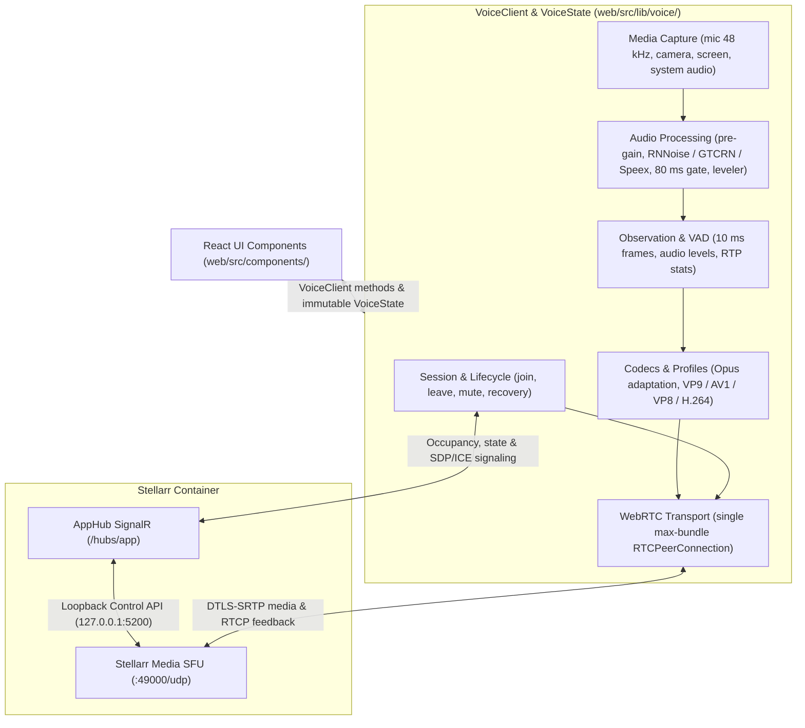

# Voice and RTC protocol

This page describes how the web client (`VoiceClient`), the SignalR hub (`AppHub`), and the media server interact during voice and video calls. All call media flows through Stellarr Media (`stellarr-media`); see [Stellarr Media](./stellarr-media.md) for SFU negotiation, track attribution, and the loopback control API.

## Client and signaling layers



UI components interact only with `VoiceClient` and the immutable `VoiceState` snapshot; they never import SignalR, `RTCPeerConnection`, audio worklets, or media-server internals directly.

## Bootstrap configuration

`GET /api/bootstrap` returns the `rtc` configuration object:

```json
{
  "protocolVersion": 1,
  "capabilities": {
    "audioCodecs": ["opus"],
    "videoCodecs": ["vp9", "vp8", "h264"],
    "audioProcessing": ["browser", "rnnoise", "gtcrn", "speex", "gate"],
    "camera": true,
    "screenShare": true,
    "screenAudio": true
  },
  "iceServers": [],
  "signalingHub": "/hubs/app",
  "mediaServer": "udp://chat.example.com:49000"
}
```

- `iceServers` is populated per request with a STUN URL, an HMAC-authenticated TURN URL, and (when `Rtc:TurnsEnabled` is `true`) a `turns:` URL.
- `mediaServer` is `udp://<Rtc:PublicHost>:<Rtc:MediaPort>`.
- The client checks `protocolVersion` before opening media devices and stops with an `unsupported` error if it is not `1`.

## Signaling

`VoiceSignal` broadcasts a participant's mute and stream state to others in the room using the following envelope:

```json
{
  "protocolVersion": 1,
  "channelId": "uuid",
  "fromUserId": "uuid",
  "toUserId": "uuid",
  "kind": "state",
  "payload": "JSON string"
}
```

- `channelId` identifies an RTC room: either a server voice channel or a two-user direct conversation.
- Clients omit `fromUserId`; `AppHub` populates it from the authenticated session. When `toUserId` is omitted, the hub broadcasts the signal to all other participants in the room.
- The backend checks authentication, channel/conversation access, recipient membership, `protocolVersion`, `kind`, and a 128 KiB payload size limit.
- Occupancy updates (`VoiceParticipantChanged`) for a server voice channel are broadcast to the server; updates for a direct call are sent only to the two participants.
- Declining a direct call (`DeclineDirectCall`) clears room occupancy and sends `DirectCallDeclined` so the caller releases local capture devices.
- Payloads are validated by typed codecs (`web/src/lib/rtc/protocol.ts`). A `state` payload has the shape `{ muted, screenStreamId, cameraStreamId }` (`cameraStreamId` is optional; absence indicates the camera is off).

> [!NOTE]
> `SendVoiceSignal` only accepts `kind: "state"`. `AppHub` rejects `offer`, `answer`, and `candidate` with `HubException("Invalid voice signal.")`. SDP descriptions and ICE candidates are exchanged exclusively with the media server via `OpenMediaSession`, `SendMediaSignal`, `MediaSignal`, and `MediaSessionClosed` (see [Stellarr Media](./stellarr-media.md#hub-leg)).

Incompatible changes to the envelope or payload format require incrementing `protocolVersion`. Optional fields can be added within version `1`.

### Hub methods and events

Defined in `web/src/lib/rtc/protocol.ts` and implemented by `AppHub` in `server/Stellarr.Api/Realtime/`:

| Type | Name | Description |
| --- | --- | --- |
| Method | `JoinVoice` | Take a seat in a voice channel or direct call |
| Method | `LeaveVoice` | Leave the current voice seat |
| Method | `SendVoiceSignal` | Relay a `state` `VoiceSignal` to one participant or the room |
| Method | `DeclineDirectCall` | End a ringing/active direct call for both participants |
| Method | `PlaySoundboard` | Schedule a soundboard clip in the room |
| Method | `GetRtcClock` | Return server Unix timestamp in milliseconds |
| Method | `OpenMediaSession` | Open a media session with Stellarr Media for the caller's seat |
| Method | `SendMediaSignal` | Send an SDP offer/answer or ICE candidate to Stellarr Media |
| Event | `VoiceParticipantChanged` | Room occupancy snapshot: `{ channelId, sequence, participants }` |
| Event | `VoiceSignal` | Relayed `VoiceSignal` envelope |
| Event | `VoiceSessionReplaced` | Account joined voice from a newer browser tab |
| Event | `DirectCallDeclined` | Remote participant declined the direct call |
| Event | `SoundboardPlayed` | Scheduled soundboard clip broadcast |
| Event | `JoinSoundPlayed` | Scheduled arrival sound broadcast |
| Event | `SoundboardChanged` | Server soundboard catalog updated |
| Event | `MediaSignal` | SDP offer/answer or track directory from Stellarr Media |
| Event | `MediaSessionClosed` | Stellarr Media ended the caller's media session |

Clients ignore any `VoiceParticipantChanged` snapshot whose `sequence` is older than the highest sequence already applied for that room.

### Soundboard synchronization

Soundboard playback uses the SignalR hub rather than mixing clips into the microphone track:

- `PlaySoundboard(channelId, soundId)` verifies that the caller holds a seat in `channelId`, checks server membership and permissions, and enforces a 5-second per-user cooldown (when rate limiting is enabled).
- `GetRtcClock()` lets clients estimate their clock offset using half the round-trip time.
- `SoundboardPlayed` broadcasts clip metadata and a shared `startsAtUnixMs` timestamp scheduled 750 ms in the future.
- Each receiver fetches and decodes the audio asset, then schedules the trimmed segment in `AudioContext` (clipping the leading offset if the event arrived late).

### Arrival sound

Users can pick a personal arrival clip (`UserPreferences.JoinSoundId`) from any server they belong to:

- Membership in the clip's source server is verified both when saving preferences and upon `JoinVoice`.
- `JoinSoundPlayed` reuses `SoundboardPlayedDto` with `triggeredByUserId` set to the joining user and `startsAtUnixMs` 750 ms in the future.
- Clips are capped at `JoinSound.MaxSeconds` (5 s) and rate-limited by `JoinSound.Cooldown` (30 s per user; cooldown suppresses the clip without blocking `JoinVoice`).
- `AttachmentAccess` permits downloading a join-sound asset whenever the listener shares a server or direct conversation with the clip's owner.
- The local `joinLeaveSound` user preference mutes both standard join/leave tones and remote arrival clips (`setArrivalsAudible`).

## State model

`VoiceState` separates hub signaling state from WebRTC media transport state:

| Field | Values | Meaning |
| --- | --- | --- |
| `transport.signaling` | `idle`, `connecting`, `connected`, `reconnecting`, `disconnected` | SignalR hub connectivity and negotiation readiness |
| `transport.media` | `idle`, `ready`, `connecting`, `connected`, `degraded`, `failed` | Aggregate WebRTC media transport health |
| `peerCount` | `number` | Number of remote participants seated in the room |
| `connectedPeerCount` | `number` | Number of remote participants with active incoming audio |

- `transport.media = ready` indicates the local session with Stellarr Media is established and no other participants are in the room (`peerCount === 0`).
- `transport.media = degraded` indicates that a remote participant's audio has not arrived past its 3-second grace window, or that the media session is being replaced (see [Stellarr Media](./stellarr-media.md#proving-media-quickly)).

> [!IMPORTANT]
> Only one active voice session is allowed per account across tabs and devices. Joining from a second tab replaces the earlier seat and sends `VoiceSessionReplaced` to the previous connection.

## Audio

- **Capture format**: 48 kHz, mono.
- **VAD and metering**: 10 ms analysis frames; speech detection never mutes the track or stops RTP packets.
- **Input gate**: Enabled by default (user-configurable), 80 ms lookahead, 600 ms hold time, attenuates silence between utterances while keeping RTP continuous.
- **Opus encoding**: 20 ms packet time, in-band FEC enabled; bitrate profiles live in `web/src/lib/voice/audioProfiles.ts` (Premium default: 64–128 kb/s, DTX off; Studio: 96–256 kb/s, DTX off; Screen audio: 96–160 kb/s stereo).
- **Source separation**: Microphone and screen-share audio use separate tracks, separate Opus profiles, and separate playback elements. Muting affects only the microphone.
- **Tab visibility**: Hiding and restoring a browser tab never tears down healthy connections; only `disconnected` or `failed` connections trigger repair.
- **TURN credential refresh**: Long-lived calls refresh TURN credentials before expiration so a media session replaced late in a call always has valid credentials.

## Screen sharing

| Profile | Max resolution | Max frame rate | Max bitrate |
| --- | ---: | ---: | ---: |
| Economy | 720p | 15 fps | 1 Mb/s |
| Balanced (default) | 1080p | 30 fps | 2.5 Mb/s |
| Sharp | 1440p | 30 fps | 5 Mb/s |
| Ultra | 2160p | 60 fps | 12 Mb/s |

- Profiles are defined in `web/src/lib/voice/screenShare.ts` and applied to both `getDisplayMedia` constraints and `RTCRtpSender` encoding parameters. Switching profiles mid-share updates constraints and sender parameters without re-prompting or renegotiating SDP.
- Codec preference order: VP9 (with 2–3 temporal layers when supported), AV1, VP8, H.264.
- Uses `contentHint = "detail"` and `degradationPreference = "maintain-resolution"`.
- Video senders use `medium` network priority while Opus audio uses `high`.

## Camera

- Managed by `VoiceClient` (`web/src/lib/voice/camera.ts`), capturing video only.
- Profiles:
  - **Low**: 854×480 @ 24 fps, 0.7 Mb/s
  - **Standard (default)**: 1280×720 @ 30 fps, 1.5 Mb/s
  - **High**: 1920×1080 @ 30 fps, 3.0 Mb/s
- Uses `contentHint = "motion"` and `degradationPreference = "maintain-framerate"`.
- `cameraStreamId` and `screenStreamId` in the `state` signal distinguish camera and screen tracks regardless of SDP m-line ordering.
- Camera video shares a `MediaStream` with the microphone (`cameraStreamId`), keeping voice and camera playback synchronized on receivers. Screen shares use a separate `MediaStream`.
- Switching camera devices uses `RTCRtpSender.replaceTrack` without renegotiating the session. Camera errors or permission denials never interrupt voice audio.

## Key source files

| Area | Source files |
| --- | --- |
| Wire protocol & payload codecs | `web/src/lib/rtc/protocol.ts`, `server/Stellarr.Api/Realtime/RtcProtocol.cs` |
| Client interface | `web/src/lib/voice/types.ts` (`VoiceClient`, `VoiceState`) |
| State store | `web/src/lib/voice/store.ts` (`VoiceStateStore`) |
| Call session management | `web/src/lib/voice/webrtc.ts`, `web/src/lib/voice/webrtcTopology.ts`, `web/src/lib/voice/webrtcParticipant.ts` |
| Media server client | `web/src/lib/voice/webrtcSfu.ts`, `web/src/lib/voice/webrtcSfuDirectory.ts`, `web/src/lib/voice/webrtcSfuHealth.ts` |
| Soundboard & arrival sounds | `web/src/adapters/soundboard.ts`, `web/src/containers/useJoinSound.ts`, `SoundboardEndpoints.cs`, `JoinSound.cs`, `AppHub.cs` |
| Opus, screen, and camera profiles | `web/src/lib/voice/audioProfiles.ts`, `web/src/lib/voice/screenShare.ts`, `web/src/lib/voice/camera.ts` |
| Microphone DSP & VAD | `web/src/lib/voice/micPipeline.ts`, `web/src/lib/voice/vad.ts`, `web/public/audio/vad-processor.js` |
| ICE/TURN credential refresh | `web/src/lib/voice/iceSession.ts` |
| Hub & media server broker | `server/Stellarr.Api/Realtime/`: `AppHub.cs`, `AppHub.Media.cs`, `MediaServerSettings.cs`, `PresenceTracker.cs`, `MediaPlane.cs`, `MediaControlClient.cs`, `MediaEventPump.cs`, `MediaEventOutbox.cs`, `MediaSessionCloser.cs` |
| Rust SFU media server | `media/` (`stellarr-media`) |

## Verification

```bash
# Web client RTC & audio unit tests
npm run typecheck -w web
npm test -w web

# Backend SignalR & voice room integration tests
dotnet test server/Stellarr.Api.Tests

# Rust SFU checks and Chromium smoke suite
cd media && cargo test
cd smoke && npm run smoke
```
