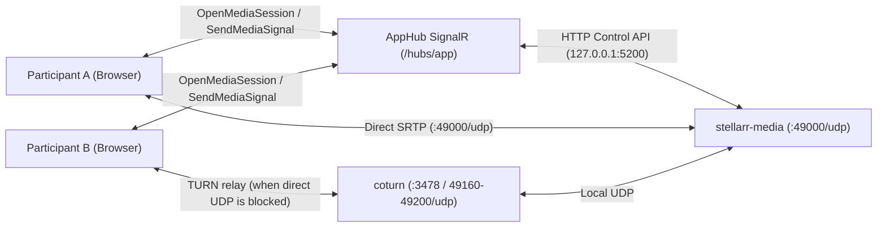
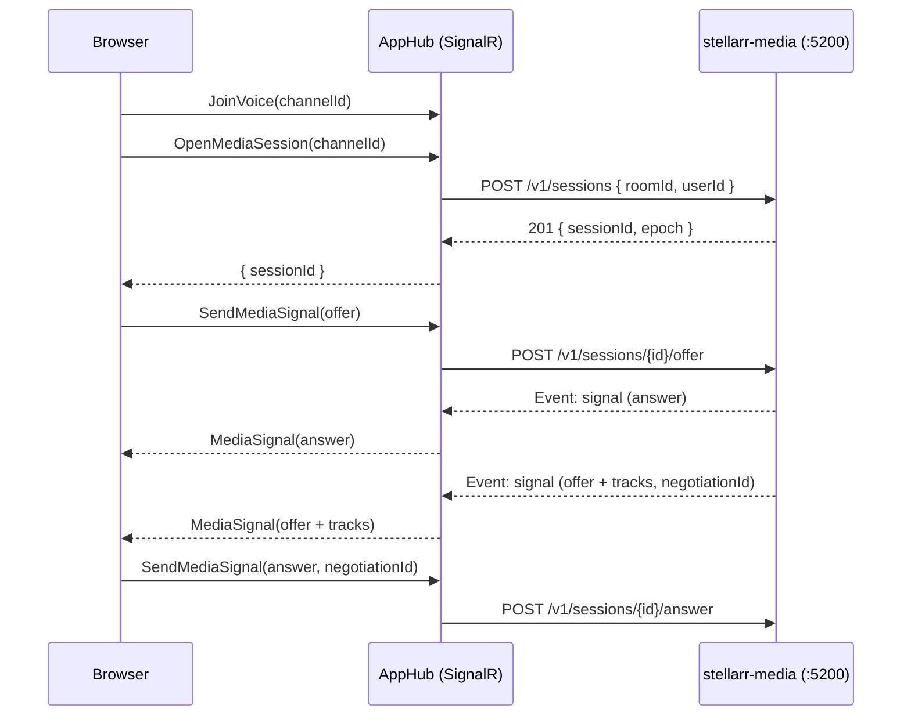

# Stellarr Media

Stellarr Media (`stellarr-media`, in `media/`) is Stellarr's Rust Selective Forwarding Unit (SFU). Every voice channel and direct call goes through it: each participant opens a single `RTCPeerConnection` to the media server, which forwards microphone, camera, and screen-share RTP packets to everyone else in the room without transcoding or mixing. Browsers never send media directly to one another.

This page covers:

1. **Hub leg**: SignalR methods and events between browser clients and `AppHub`.
2. **Control API**: Loopback HTTP protocol between `AppHub` and `stellarr-media`.
3. **Media plane**: ICE-lite transport, SDP negotiation, RTP forwarding, and resource limits.

See [Voice and RTC protocol](./rtc-protocol.md) for bootstrap configuration, `VoiceSignal` state messages, `VoiceState`, and audio/video profiles.

## Overview

| Aspect | Behavior |
| --- | --- |
| WebRTC engine | `str0m` (sans-IO ICE, DTLS, SRTP, RTP/RTCP) |
| Transport | ICE-lite on a single UDP socket (`0.0.0.0:49000`) |
| Forwarded media | Microphone audio, camera video, screen video, and screen audio |
| Media processing | Packet-level RTP forwarding; no decoding, mixing, or transcoding |
| Authorization | `AppHub` authorizes seats; `stellarr-media` only accepts commands on its loopback control API |
| Signaling path | Browser ↔ `AppHub` (SignalR) ↔ `stellarr-media` (`127.0.0.1:5200`) |
| Connections per client | Single `RTCPeerConnection` (`bundlePolicy: "max-bundle"`) |
| Offer direction | Browser offers published tracks (`sendonly`); `stellarr-media` offers forwarded tracks (`sendonly` to the receiver) |
| Glare resolution | Browser is the impolite peer; `stellarr-media` is the polite peer |
| Track attribution | Server-issued directory mapping SDP `mid` → `{ userId, kind, streamId }` |
| Direct calls | Routed through the media server just like server voice channels |

## Topology



Because all media goes through the container, any browser outside the Docker host needs the media server's public candidate: set `PUBLIC_IP` and forward UDP `STELLARR_MEDIA_PORT` (default `49000`) to the host on the same external port. Without `PUBLIC_IP`, the media server advertises only the container's internal address, which off-host browsers can reach only through TURN (`coturn`). See [Requirements](install/requirements.md#behind-nat).

`GET /api/bootstrap` returns:

```json
{
  "protocolVersion": 1,
  "mediaServer": "udp://chat.example.com:49000"
}
```

- `mediaServer` is `udp://{Rtc:PublicHost}:{Rtc:MediaPort}` (falling back to `localhost` when `Rtc:PublicHost` is unset). It is used for diagnostics; actual connection addresses come from SDP ICE candidates.

## Hub leg

`AppHub` exposes two SignalR methods and two events for the media server:

| Type | Name | Description |
| --- | --- | --- |
| Method | `OpenMediaSession` | Allocate a media session for the caller's active voice seat |
| Method | `SendMediaSignal` | Send an SDP offer/answer or ICE candidate to `stellarr-media` |
| Event | `MediaSignal` | Deliver an SDP offer/answer or track directory from `stellarr-media` |
| Event | `MediaSessionClosed` | Notify the client that the media session was closed by the media server |

### `OpenMediaSession(channelId) → { sessionId }`

- Requires the caller to hold an active seat in `channelId` (via `JoinVoice`).
- If the connection already has a media session, the previous session is detached and closed asynchronously in the background. Because `stellarr-media` enforces at most one session per `userId`, out-of-order close requests cannot affect the new session.
- Returns an opaque `sessionId` that must accompany all subsequent `SendMediaSignal` calls. Clients ignore any `MediaSignal` or `MediaSessionClosed` event carrying a different `sessionId` or `channelId`.
- Error responses:
  - `HubException("Invalid channelId.")` when `channelId` is not a valid UUID.
  - `HubException("Not seated in this voice room.")` when the caller has no seat in `channelId` (including if the seat ended while the session was being created).
  - `HubException("Media server is unavailable.")` when `stellarr-media` is unreachable, times out, or is undergoing a startup/event-loss reset.

Clients call `OpenMediaSession` after every `JoinVoice` (initial join, moderator move, hub reconnect, or session recovery) and create a fresh `RTCPeerConnection` for each session.

### `MediaSignal` envelope

```json
{
  "protocolVersion": 1,
  "channelId": "uuid",
  "sessionId": "opaque",
  "kind": "offer | answer | candidate | tracks",
  "payload": "JSON string"
}
```

| Kind | Direction | Payload schema |
| --- | --- | --- |
| `offer` | Browser → Media | `{ "type": "offer", "sdp": "…" }` |
| `answer` | Media → Browser | `{ "type": "answer", "sdp": "…" }` |
| `offer` | Media → Browser | `{ "type": "offer", "sdp": "…", "negotiationId": 7, "tracks": [Track] }` |
| `answer` | Browser → Media | `{ "type": "answer", "sdp": "…", "negotiationId": 7 }` |
| `candidate` | Browser → Media | `RTCIceCandidateInit` object, or `null` (end-of-candidates) |
| `tracks` | Media → Browser | `{ "tracks": [Track] }` |

Each `Track` entry in the directory has the shape:

```json
{ "mid": "fAk", "userId": "uuid", "kind": "audio | video", "streamId": "…" }
```

- **Validation**: `AppHub` verifies `protocolVersion == 1`, `kind` (`offer`, `answer`, or `candidate` from browser), seat ownership, `sessionId` ownership, payload UTF-8 byte length ≤ 128 KiB, and payload schema. Invalid signals throw `HubException("Invalid media signal.")` (or `HubException("Invalid ChannelId.")`).
- **Control API forwarding**:
  - `409 stale-negotiation` on a stale answer returns normally (`stellarr-media` discards stale answers by design).
  - `422` or `413` throws `HubException("Invalid media signal.")`.
  - `404 unknown-session` returns normally and triggers `MediaSessionClosed` with `reason: "media-restarted"`.
  - Other failures throw `HubException("Media server is unavailable.")`.
- **Server-to-browser events**: `MediaSignal` carries only `offer`, `answer`, and `tracks`. `stellarr-media` includes all ICE host candidates directly in its SDP and never trickles candidates.
- Every `tracks` list contains the complete track directory for the session, never a partial diff.

### Negotiation rules



- **Browser offers (publishing)**: The browser sends an SDP offer whenever its published tracks change (initial join, camera toggle, screen-share toggle). The initial offer after `OpenMediaSession` must contain at least one m-line; a receive-only client offers a `recvonly` audio transceiver (answered `inactive`).
- **Server offers (forwarding)**: `stellarr-media` sends an offer whenever forwarded tracks for the session change, but only after answering the browser's first offer.
- **Ordering**: Signals from `stellarr-media` are delivered in sequence order. The browser serializes its outgoing `SendMediaSignal` calls, awaiting each hub response before sending the next.
- **Glare**: The browser is impolite and drops any incoming media-server offer while its own offer is in flight. `stellarr-media` is polite: if a browser offer arrives while a server offer is pending, it rolls back the server offer, answers the browser's offer, and issues a new server offer with an incremented `negotiationId`.
- **Stale answers and timeouts**: Each server offer carries a monotonically increasing `negotiationId` (starting at `1`), which the browser echoes in its `answer`. Answers with a non-matching `negotiationId` are rejected with `409 stale-negotiation`. If a server offer receives no answer or competing browser offer within 10 s, it is rolled back and re-offered; after 3 consecutive unanswered offers, the session is closed with `error`.
- **Immediate client recovery**: If the browser fails to apply a remote SDP description or `SendMediaSignal` is rejected by the hub, the client immediately replaces the media session rather than waiting for server timeouts.

> [!IMPORTANT]
> Published tracks must be added on dedicated transceivers via `addTransceiver(track, { direction: "sendonly", streams: [stream] })`. Do not use `addTrack`: browsers may attach `addTrack` to an existing server-created transceiver, which `stellarr-media` never accepts incoming media on (answering `sendonly` or `inactive`).

### Track directory

Because all remote media arrives over a single `RTCPeerConnection`, the client attributes incoming tracks using the server-provided directory:

- `mid`: Matches the receiving transceiver's SDP `a=mid` value, assigned by `stellarr-media`.
- `userId`: Lowercase UUID of the publishing user, bound from the authenticated seat.
- `streamId`: Stream identifier declared by the publisher (`""` if none), matched against `screenStreamId` and `cameraStreamId` in the publisher's `VoiceSignal` (`kind: "state"`) to distinguish microphone, camera, and screen tracks.
- **Shared microphone and camera stream**: A publisher places its microphone and camera tracks into a single `MediaStream` (one `msid`) per call and advertises that stream ID as `cameraStreamId` while the camera is active. `stellarr-media` preserves the publisher's `msid` in forwarded offers so receiving browsers keep voice and camera synchronized. Screen shares use a separate `MediaStream`.
- **Distinguishing microphone vs. screen audio**: On the receiving side, an incoming audio track is treated as the publisher's microphone if its stream matches `cameraStreamId` or if the audio track was registered on that stream before any video track. It is treated as screen-share audio if its stream matches `screenStreamId` or if a video track was registered on that stream first. Because the track directory lists a screen share's video track before its audio track, receivers classify screen audio accurately even before the publisher's `state` signal arrives.
- **Holding unattributed tracks**: Tracks whose `mid` is not yet in the directory, or whose `userId` is not in the current `VoiceParticipantChanged` occupancy snapshot, remain muted/unplayed until both include them.
- **In-place track swaps**: When a publisher switches capture devices and updates its stream ID without adding a new transceiver, `stellarr-media` emits a `tracks` signal without renegotiating SDP.

### `MediaSessionClosed`

```json
{ "channelId": "uuid", "sessionId": "opaque", "reason": "media-restarted | transport-timeout | error" }
```

Sent only when the media server closes a session while the user's voice seat is still active:

| Reason | Cause |
| --- | --- |
| `media-restarted` | `stellarr-media` restarted, the API reset it after an event-log gap, or a signal returned `404 unknown-session` |
| `transport-timeout` | ICE + DTLS + SRTP failed to connect within 30 s, or remained disconnected for 30 s |
| `error` | Protocol or resource limit exceeded (e.g. 3 unanswered offers or SDP size limit) |

Sessions closed because the user left the seat or opened a replacement session do not emit `MediaSessionClosed`.

## Seat and session lifecycle

A media session is bound to an active voice seat in `PresenceTracker`. `AppHub` and moderation endpoints close the media session whenever a seat changes:

| Trigger | Source |
| --- | --- |
| User leaves voice | `LeaveVoice` |
| SignalR connection disconnects | `OnDisconnectedAsync` |
| Newer browser tab takes the seat | `JoinVoice` (`VoiceSessionReplaced`) |
| User switches voice rooms | `JoinVoice` (from a previous room) |
| Direct call declined or user blocked | `DeclineDirectCall`, `SocialEndpoints` |
| Moderator kicks or moves user in voice | `VoiceModerationEndpoints` |
| Moderator kicks or bans user from server | `ModerationEndpoints` |

`PresenceTracker` detaches the session immediately in memory and enqueues a `DELETE /v1/sessions/{sessionId}` job in `MediaSessionCloser` (which retries every 2 s up to a bounded queue of 4,096 pending deletes). Calling `JoinVoice` again for the room the connection already occupies is a no-op and preserves the existing session.

## Client state and recovery

### `VoiceState` mapping

| State / Field | Condition |
| --- | --- |
| `peerCount` | Number of other participants seated in the room |
| `connectedPeerCount` | Number of seated participants whose microphone `inbound-rtp` packet counter is advancing (or who have an active transceiver while muted) |
| `transport.media = connecting` | Peer connection is not yet `connected`, or outgoing audio RTP packets have not yet advanced |
| `transport.media = ready` | Peer connection is `connected`, outgoing audio RTP is verified, and `peerCount === 0` |
| `transport.media = connected` | Peer connection is `connected`, and every other participant's microphone either arrives or is still within its arrival grace, with at least one arriving |
| `transport.media = degraded` | A microphone is missing past its arrival grace, connection is `disconnected`/`failed`, outgoing audio is unverified after 3 stats samples (`voiceClient.mediaServerStalled`), or session replacement is in progress |
| `transport.media = failed` | Automatic session replacement attempts exhausted (`voiceClient.mediaServerLost`) |

### Session recovery

- If the peer connection stays `disconnected` for more than 10 s, transitions to `failed`/`closed`, receives `MediaSessionClosed`, fails SDP application, or fails `OpenMediaSession`/`SendMediaSignal`, the client closes the `RTCPeerConnection` and opens a replacement media session while keeping local microphone, camera, and screen tracks alive.
- The client performs up to 3 automatic replacement attempts with backoff delays of `2 s`, `4 s`, and `8 s`. Once outgoing audio RTP is verified (or on a fresh `JoinVoice`), the retry counter resets. If all 3 attempts fail, `transport.media` enters `failed` (`voiceClient.mediaServerLost`).
- Clicking **Reconnect** in the call banner repairs the session in place: it refreshes ICE credentials, calls `JoinVoice` for the current room (keeping the seat without broadcasting a leave/join to other participants), and opens a new media session with a reset retry budget.

### Proving media quickly

- Transport health is verified from cumulative RTP counters (`getStats`), sampled on a 3 s interval. When the connection first reaches `connected` or a new participant joins, the client runs rapid initial checks at `250 ms`, `500 ms`, `1 s`, and `2 s` until RTP flow is confirmed, then resumes the normal 3 s interval.
- A newly joined participant's microphone is treated as pending (not missing) for a 3 s grace window starting from when the connection came up or when the participant joined, whichever is later.
- Each remote microphone transceiver is re-evaluated at most once every 500 ms; samples taken less than 500 ms apart keep the previous status so DTX silence packets (sent every 400 ms) are not mistaken for a stalled stream.

## Control API (`127.0.0.1:5200`)

`AppHub` is the only client of the HTTP/1.1 JSON control API:

- Every endpoint except `GET /v1/health` requires `Authorization: Bearer <secret>` (unless bound to loopback with an empty secret). Invalid or missing credentials return `401`.
- Error responses have the shape `{ "error": "<code>", "detail": "<text>" }`.
- `sessionId` and `epoch` are 32-character lowercase hex strings; `roomId` and `userId` are lowercase UUIDs.

| Endpoint | Success response | Error statuses |
| --- | --- | --- |
| `GET /v1/health` | `200 { "status": "ok", "version": "…", "epoch": "…", "rooms": 0, "sessions": 0 }` | None |
| `POST /v1/reset` | `200 { "epoch": "…", "seq": 0 }` | None |
| `POST /v1/sessions` (`{ "roomId", "userId" }`) | `201 { "sessionId": "…", "epoch": "…" }` | `422 invalid-request` |
| `DELETE /v1/sessions/{sessionId}` | `204` (idempotent for unknown sessions) | None |
| `POST /v1/sessions/{sessionId}/offer` (`{ "sdp" }`) | `204` | `404 unknown-session`, `422 invalid-sdp`, `422 limit-exceeded` |
| `POST /v1/sessions/{sessionId}/answer` (`{ "sdp", "negotiationId" }`) | `204` | `404 unknown-session`, `409 stale-negotiation`, `422 invalid-sdp` |
| `POST /v1/sessions/{sessionId}/candidate` (`{ "candidate" }`) | `204` | `404 unknown-session`, `422 invalid-candidate` |
| `GET /v1/events?epoch=…&after=…&waitMs=…` | `200 { "epoch": "…", "reset": false, "events": [Event] }` | `422 invalid-request` |
| `GET /v1/stats` | `200 { "epoch": "…", "rooms": [...] }` | None |

Additional status codes: `413 payload-too-large` (request body > 256 KiB), `404 not-found`, `405 method-not-allowed`, `503 unavailable`.

### Event long-polling (`GET /v1/events`)

Returns immediately when events with `seq > after` exist, or waits up to `waitMs` (max `30000`; the API polls with `waitMs=25000` and a 30 s HTTP timeout). Returns up to 256 events per response:

```json
{ "seq": 41, "type": "signal", "sessionId": "…", "kind": "answer | offer | tracks", "payload": { } }
{ "seq": 42, "type": "closed", "sessionId": "…", "reason": "transport-timeout | error" }
```

- `epoch` identifies the `stellarr-media` process instance. If the requested `epoch` does not match the running epoch, or if `after` falls outside the 4,096-event ring buffer, `stellarr-media` responds immediately with `{ "epoch": "<current>", "reset": true, "events": [] }`.
- On `reset: true`, the API closes all tracked sessions from the stale epoch (emitting `MediaSessionClosed` with `media-restarted`), calls `POST /v1/reset` if the epoch was unchanged but the ring buffer overflowed, and resumes polling from `after=0`.

### Diagnostics (`GET /v1/stats`)

```json
{
  "epoch": "…",
  "rooms": [
    {
      "roomId": "uuid",
      "sessions": [
        {
          "sessionId": "…",
          "userId": "uuid",
          "state": "new | connecting | connected | disconnected",
          "ageMs": 0,
          "published": 2,
          "forwarded": 6,
          "ingress": { "packets": 0, "bytes": 0 },
          "egress": { "packets": 0, "bytes": 0 }
        }
      ]
    }
  ]
}
```

`ingress` and `egress` count media payload packets and bytes (excluding RTP headers, RTCP, and RTX retransmissions).

## Media plane behavior

### Transport

- Single UDP socket (`0.0.0.0:49000`); incoming packets are demultiplexed by remote socket address (and by STUN username fragment on the initial connectivity check).
- Each session accepts connectivity checks from at most 64 distinct remote addresses over its lifetime.
- ICE-lite: `stellarr-media` responds to STUN checks and acts as DTLS server.
- Advertised host candidates (IPv4 only): `STELLARR_MEDIA_PUBLIC_IP:STELLARR_MEDIA_PUBLIC_PORT` (when set) followed by the primary local IPv4 address on the bound port (used for internal `coturn` relay).

### Forwarding

- Every session in a `roomId` receives all tracks published by other sessions in the same room and never receives its own tracks.
- Per connection, `stellarr-media` rewrites SSRC, payload type, RTP header extension IDs, and sequence numbers/timestamps while leaving media payloads untouched after SRTP decryption and re-encryption.
- Supported codecs: Opus, VP9, VP8, H.264, AV1. Publisher codec order is preserved, and publisher Opus `a=fmtp` parameters are echoed back so the browser configures its encoder according to the selected profile.
- Audio level RTP header extensions are forwarded.
- NACK, RTX, transport-wide congestion control (TWCC), and keyframe requests (PLI/FIR, rate-limited to once per second per track) are handled per leg.

### Resource limits

| Limit | Value | Behavior when exceeded |
| --- | ---: | --- |
| SDP length | 128 KiB | `422 invalid-sdp` on browser SDP; session closed with `error` if server SDP exceeds limit |
| Published tracks per session | 8 | `422 limit-exceeded` |
| Control API request body | 256 KiB | `413 payload-too-large` |
| Usable trickled ICE candidates per session | 64 | Subsequent candidates return `204` and are ignored |
| Remote peer addresses per session | 64 | Checks from additional addresses are dropped |
| Initial connection timeout (ICE + DTLS + SRTP) | 30 s | Closed with `transport-timeout` |
| Disconnected timeout | 30 s | Closed with `transport-timeout` |
| Consecutive unanswered server offers | 3 | Closed with `error` |

### Current limitations

`stellarr-media` does not currently implement:

- **Downlink adaptation for slow receivers**: Every receiver gets the publisher's full stream, without VP9 temporal-layer dropping or simulcast.
- **SDP m-line recycling**: Inactive m-lines are not reused within a session. A long session with many track toggles eventually reaches the 128 KiB SDP limit and automatically reconnects with a fresh session.
- **Selective video subscription or active-speaker filtering**: All published tracks in a room are forwarded to every participant.
- **Session persistence across hub reconnects or ICE restarts**: The client opens a new session instead.
- **IPv6 or direct ICE-TCP**: The media socket uses IPv4 UDP only; clients restricted to TCP connect through `coturn`.

> [!WARNING]
> Call media is encrypted in transit between each browser and `stellarr-media` (DTLS-SRTP), not end-to-end encrypted between browsers. Because `stellarr-media` terminates SRTP on each leg to forward packets, audio and video are decrypted in process memory on the host running the container.

## Process configuration

### `stellarr-media` environment variables

| Variable | Default | Description |
| --- | --- | --- |
| `STELLARR_MEDIA_BIND` | `0.0.0.0:49000` | UDP media bind address |
| `STELLARR_MEDIA_PUBLIC_IP` | empty | Public IPv4 address advertised in ICE host candidates |
| `STELLARR_MEDIA_PUBLIC_PORT` | port of `STELLARR_MEDIA_BIND` | Public UDP port advertised with `STELLARR_MEDIA_PUBLIC_IP` |
| `STELLARR_MEDIA_ADVERTISE` | empty | Comma-separated `ip:port` list overriding derived host candidates |
| `STELLARR_MEDIA_CONTROL_BIND` | `127.0.0.1:5200` | HTTP control API bind address |
| `STELLARR_MEDIA_CONTROL_SECRET` | empty | Bearer token required by the control API (required when not bound to loopback) |
| `STELLARR_MEDIA_LOG` | `info` | `tracing` log filter (e.g. `info,stellarr_media=debug`) |

### ASP.NET Core API settings

| Setting | Default | Description |
| --- | --- | --- |
| `Rtc:MediaControlUrl` | `http://127.0.0.1:5200` | Base URL of the `stellarr-media` control API |
| `Rtc:MediaControlSecret` | empty | Shared bearer secret |
| `Rtc:MediaPort` | `49000` | Public UDP port advertised in `GET /api/bootstrap` (`1–65535`) |
